<div align="center">

<br>

# 🦈 AI Engineer Roadmap

### *From fundamentals to mastery in 13 weeks*

<br>


<br>

**A training program by SharkStack**
<br>
<sub>Followed by a potential permanent position, based on your performance and trainer feedback.</sub>

<br>

[🌊 Journey](#-the-journey-at-a-glance) &nbsp;·&nbsp;
[🗺️ Overview](#️-overview) &nbsp;·&nbsp;
[📚 Weekly Plan](#-week-by-week) &nbsp;·&nbsp;
[🏆 Capstone](#-week-13--capstone-project) &nbsp;·&nbsp;
[✅ Progress](#-progress-tracker)

</div>

<br>

---

## 🌊 The journey at a glance

```mermaid
flowchart LR
    A["🌱 FOUNDATIONS<br/>W1 · W2 · W3"] --> B["🔬 MACHINE LEARNING<br/>W4 · W5"]
    B --> C["🤖 OPEN SOURCE & AGENTS<br/>W6 · W7"]
    C --> D["⚙️ AUTOMATION<br/>W8 · W9"]
    D --> E["🎙️ MULTIMODAL<br/>W10"]
    E --> F["🚀 PRODUCTION<br/>W11 · W12"]
    F --> G["🏆 CAPSTONE<br/>W13"]

    style A fill:#e8f5e9,stroke:#2ea44f,color:#0b1220
    style B fill:#e3f2fd,stroke:#0A66C2,color:#0b1220
    style C fill:#f3e5f5,stroke:#8A2BE2,color:#0b1220
    style D fill:#fff3e0,stroke:#f59e0b,color:#0b1220
    style E fill:#fce4ec,stroke:#e11d74,color:#0b1220
    style F fill:#e0f7fa,stroke:#0891b2,color:#0b1220
    style G fill:#fff9c4,stroke:#eab308,color:#0b1220
```



<div align="center">

| 🌱 Foundations | 🔬 Machine Learning | 🤖 Open Source & Agents |
|:---:|:---:|:---:|
| **W1** APIs & Chatbots | **W4** ML Fundamentals | **W6** Local LLMs & Deployment |
| **W2** Prompting | **W5** Deep Learning | **W7** Agents & Workflows |
| **W3** Embeddings & RAG | | |

| ⚙️ Automation | 🎙️ Multimodal | 🚀 Production |
|:---:|:---:|:---:|
| **W8** n8n & Zapier | **W10** Speech & Vision | **W11** FastAPI Backend |
| **W9** Custom Tools | | **W12** Docker & Cloud |

### 🏆 **W13** · Capstone

</div>

<br>

---

## 🗺️ Overview

| Week | Theme | You will build |
|:---:|:---|:---|
| 1️⃣ | Introduction to AI Engineering | A simple chatbot wrapper |
| 2️⃣ | AI Models & Prompting | A prompt optimizer |
| 3️⃣ | Embeddings & Vector Databases | A RAG pipeline |
| 4️⃣ | Custom ML: Fundamentals | A scikit-learn classifier |
| 5️⃣ | Custom ML: Deep Learning | CNNs, GANs, RNNs, fine-tuned HF models |
| 6️⃣ | Open-Source Models & Deployment | A local LLM with an API wrapper |
| 7️⃣ | Agents & Agentic Workflows | Tool-using agents |
| 8️⃣ | Modern AI Automation Tools | n8n and Zapier automations |
| 9️⃣ | Advanced Automation & Custom Tools | Serverless functions, custom n8n nodes |
| 🔟 | Multimodal Systems & Speech | STT, TTS and vision pipelines |
| 1️⃣1️⃣ | Production Backend Architecture | A FastAPI service with caching and a DB |
| 1️⃣2️⃣ | Deployment & Scaling | A containerized cloud deployment |
| 1️⃣3️⃣ | Capstone Project | An end-to-end AI system |

<br>

---

## 📚 Week by week

> 💡 **Tip:** click a week to expand it.

<br>

### 🌱 Phase 1 · Foundations

<details>
<summary><b>📅 Week 1 &nbsp;·&nbsp; Introduction to AI Engineering</b></summary>

<br>

**🧠 Theory**
- AI engineering basics
- API fundamentals and authentication
- OpenAI API key setup

**🛠️ Practical**
- First API calls: OpenAI chat completions
- Build a simple chatbot wrapper

**📖 Resources** &nbsp;→&nbsp; OpenAI API Documentation · Anthropic Claude API

</details>

<details>
<summary><b>📅 Week 2 &nbsp;·&nbsp; Working with AI Models & Prompting</b></summary>

<br>

**🧠 Theory**
- Tokens, temperature, top-p sampling
- Few-shot prompting and chain-of-thought
- Frequency and presence penalties

**🛠️ Practical**
- Prompt engineering for various tasks
- Build a prompt optimizer

**📖 Resources** &nbsp;→&nbsp; OpenAI Prompt Engineering · Anthropic Prompt Guide

</details>

<details>
<summary><b>📅 Week 3 &nbsp;·&nbsp; Embeddings & Vector Databases</b></summary>

<br>

**🧠 Theory**
- Text embeddings and semantic search
- Vector database fundamentals
- RAG (Retrieval-Augmented Generation) concepts

**🛠️ Practical**
- Generate embeddings with OpenAI/Anthropic
- Build a RAG pipeline with Pinecone/ChromaDB
- Semantic search implementation

**📖 Resources** &nbsp;→&nbsp; OpenAI Embeddings · Pinecone Docs · ChromaDB Docs

</details>

<br>

### 🔬 Phase 2 · Machine Learning

<details>
<summary><b>📅 Week 4 &nbsp;·&nbsp; Custom ML Models: Fundamentals</b></summary>

<br>

**🧠 Theory**
- Supervised vs unsupervised learning
- Training, validation and test splits
- Loss functions and optimization

**🛠️ Practical**
- Build a classification model with scikit-learn
- Fine-tune embeddings for domain-specific tasks
- Model evaluation and metrics

**📖 Resources** &nbsp;→&nbsp; Scikit-learn Guide · Fast.ai Practical Deep Learning

</details>

<details>
<summary><b>📅 Week 5 &nbsp;·&nbsp; Custom ML Models: Deep Learning</b></summary>

<br>

**🧠 Theory**
- Neural network basics (PyTorch/TensorFlow)
- Transfer learning fundamentals
- Fine-tuning pre-trained models

**🛠️ Practical**
- Build CNNs, GANs and RNNs with PyTorch
- Fine-tune Hugging Face models for custom tasks
- Model checkpointing and evaluation

**📖 Resources** &nbsp;→&nbsp; PyTorch Documentation · Hugging Face Course · Hugging Face Transformers

</details>

<br>

### 🤖 Phase 3 · Open Source & Agents

<details>
<summary><b>📅 Week 6 &nbsp;·&nbsp; Open-Source Models & Deployment</b></summary>

<br>

**🧠 Theory**
- Open-source alternatives (Mistral, Llama, etc.)
- Model quantization and optimization
- Local model serving

**🛠️ Practical**
- Deploy an open-source LLM locally (Ollama/LM Studio)
- Implement inference with Hugging Face
- Build an API wrapper around custom models

**📖 Resources** &nbsp;→&nbsp; Hugging Face Models Hub · Ollama Documentation · vLLM for Fast Inference

</details>

<details>
<summary><b>📅 Week 7 &nbsp;·&nbsp; Agents & Agentic Workflows</b></summary>

<br>

**🧠 Theory**
- Agent architectures (ReAct, tool use)
- Multi-step reasoning and planning
- Tool integration patterns

**🛠️ Practical**
- Build agents with LangChain/LlamaIndex
- Implement function calling (Claude tool use/OpenAI)
- Create multi-step workflows

**📖 Resources** &nbsp;→&nbsp; LangChain Documentation · LlamaIndex Docs · Claude Tool Use

</details>

<br>

### ⚙️ Phase 4 · Automation

<details>
<summary><b>📅 Week 8 &nbsp;·&nbsp; Modern AI Automation Tools</b></summary>

<br>

**🧠 Theory**
- n8n, Zapier and Make.com for AI-powered workflows
- RPA (Robotic Process Automation) vs AI-driven automation

**🛠️ Practical**
- Set up real-world automations with n8n and Zapier, e.g. automatic email responses with NLP models

**📖 Resources** &nbsp;→&nbsp; n8n Docs · Zapier Automation Guide

</details>

<details>
<summary><b>📅 Week 9 &nbsp;·&nbsp; Advanced Automation & Custom Tools</b></summary>

<br>

**🧠 Theory**
- Building custom integrations
- Webhook handling and async processing
- Error handling and retry logic

**🛠️ Practical**
- Build serverless functions (AWS Lambda/Google Cloud Functions)
- Create custom n8n nodes
- Implement robust error handling and logging

**📖 Resources** &nbsp;→&nbsp; AWS Lambda Python Guide · Google Cloud Functions · n8n Custom Nodes

</details>

<br>

### 🎙️ Phase 5 · Multimodal

<details>
<summary><b>📅 Week 10 &nbsp;·&nbsp; Multimodal Systems & Speech</b></summary>

<br>

**🧠 Theory**
- Multimodal AI concepts (text + image + audio)
- Speech-to-text and text-to-speech
- Vision models and image understanding

**🛠️ Practical**
- Build an STT pipeline with Whisper/AssemblyAI
- Implement TTS with ElevenLabs/Azure
- Vision tasks with Claude vision or open-source models
- Combine modalities in one unified system

**📖 Resources** &nbsp;→&nbsp; OpenAI Whisper API · ElevenLabs TTS · Claude Vision

</details>

<br>

### 🚀 Phase 6 · Production

<details>
<summary><b>📅 Week 11 &nbsp;·&nbsp; Production Backend Architecture</b></summary>

<br>

**🧠 Theory**
- API design patterns (FastAPI/Flask)
- Database design for AI systems
- Caching and performance optimization

**🛠️ Practical**
- Build a production API with FastAPI
- Implement caching (Redis)
- Database integration (PostgreSQL/MongoDB)
- Load testing and monitoring

**📖 Resources** &nbsp;→&nbsp; FastAPI Documentation · Redis Documentation · SQLAlchemy ORM

</details>

<details>
<summary><b>📅 Week 12 &nbsp;·&nbsp; Deployment & Scaling</b></summary>

<br>

**🧠 Theory**
- Containerization (Docker)
- Kubernetes basics
- CI/CD pipelines for ML

**🛠️ Practical**
- Containerize an ML application with Docker
- Deploy to the cloud (AWS/GCP/Azure)
- Implement basic autoscaling
- Monitor model performance in production

**📖 Resources** &nbsp;→&nbsp; Docker Documentation · Kubernetes Basics · GitHub Actions for CI/CD

</details>

<br>

---

## 🏆 Week 13 · Capstone Project

> *Everything you learned, in one end-to-end system.*

| Layer | Component |
|:---:|:---|
| 🧬 **Model** | Custom fine-tuned ML model |
| 🤖 **Agent** | LLM agent with tool use |
| 🔎 **Knowledge** | Vector database and RAG |
| 🎧 **Senses** | Multimodal capabilities |
| 🔁 **Automation** | Automated workflows (n8n integration) |
| 🌐 **Backend** | Production FastAPI backend |
| 📦 **Delivery** | Containerized deployment |
| 🎤 **Wrap-up** | Project presentation and code review |

### 💡 Project ideas

| | Idea |
|:---:|:---|
| 📄 | AI-powered document processing pipeline |
| 🎧 | Intelligent customer support agent with custom intent classification |
| 🖼️ | Multimodal content analysis system |
| 🔄 | Automated data pipeline with LLM validation |

<br>

---

## ✅ Progress tracker


```text
[█░░░░░░░░░░░░]  8%
```

### 🌱 Week 1 &nbsp;·&nbsp; Complete

- [x] **Task 1** · Memory Chatbot Agent *(local Ollama agent with memory, tools and model switching)*
- [x] **Task 2** · Memory Chatbot by LLMS *(`Memory Chatbot by LLMS T2`)*
- [x] **Task 3** · Token Optimizer *(`Token Optimizer T3`)*
- [x] **Task 4** · Enterprise RAG Project *(`Enterprise RAG Project` / EnterpriseIQ)*

### 🗓️ Up next

- [ ] **Week 2** · Prompting
- [ ] **Week 3** · Embeddings and RAG
- [ ] **Week 4** · ML fundamentals
- [ ] **Week 5** · Deep learning
- [ ] **Week 6** · Open-source models
- [ ] **Week 7** · Agents
- [ ] **Week 8** · Automation tools
- [ ] **Week 9** · Custom automation
- [ ] **Week 10** · Multimodal
- [ ] **Week 11** · Backend
- [ ] **Week 12** · Deployment
- [ ] **Week 13** · Capstone

<br>

---

<div align="center">

<br>

### 🦈 SharkStack AI Engineer Program

*Learn it. &nbsp;Build it. &nbsp;Ship it.*

<br>

</div>
